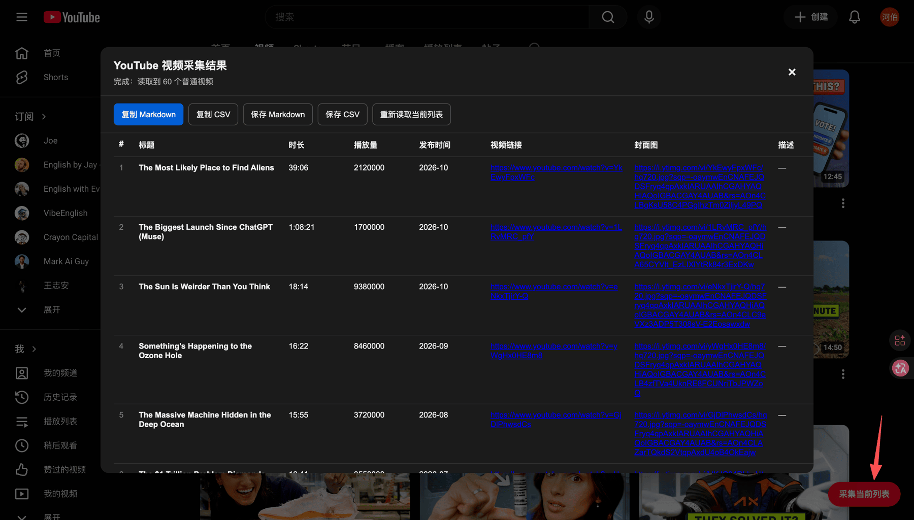

# OMA Userscripts

日常网站的轻量增强脚本合集：**X / Threads / Instagram / YouTube / 小红书** 等常用平台。
每个脚本都是单文件 `.user.js`，配合 Tampermonkey / Violentmonkey / Userscripts(Safari) 使用，**不采集任何数据、不联网上报、不依赖后端**。

[](LICENSE)
[](docs/publishing.md)
[](https://greasyfork.org/zh-CN/scripts/602329)

> English: A small collection of MIT-licensed userscripts for everyday sites (X, Threads, Instagram, YouTube, Xiaohongshu). Single-file, no tracking, no backend. Install from [Greasy Fork](https://greasyfork.org/zh-CN/scripts/602329) or straight from GitHub raw.

[](scripts/youtube-channel-videos/screenshot.png)

> 采集完成后自动去掉合辑 / 播放列表 / Shorts / 直播 / 推荐，只留频道自己的普通视频，并补齐时长、播放量、发布时间；可复制或导出 Markdown / CSV。

---

## 脚本列表

<!-- scripts:start -->
| 脚本 | 平台 | 功能 | 安装 |
| --- | --- | --- | --- |
| [小红书 AI 对话 Markdown 复制器](scripts/xiaohongshu-ai-copy/) | 小红书 | 悬停小红书「点点」的消息复制 AI 回复的 Markdown 原文，也可以一键复制整个对话 | Greasy Fork（待上架） · [GitHub](https://raw.githubusercontent.com/wyf0931/oma-userscripts/main/scripts/xiaohongshu-ai-copy/xiaohongshu-ai-copy.user.js) |
| [YouTube 频道视频列表采集器](scripts/youtube-channel-videos/) | YouTube | 只读取 YouTube 频道「视频」页签里属于该频道的普通视频，可复制或导出为 Markdown / CSV 文件 | [Greasy Fork](https://greasyfork.org/zh-CN/scripts/602329) · [GitHub](https://raw.githubusercontent.com/wyf0931/oma-userscripts/main/scripts/youtube-channel-videos/youtube-channel-videos.user.js) |
<!-- scripts:end -->

> 安装时脚本管理器会弹出确认页，点「安装」即可；首次使用请在 Tampermonkey 的「已安装脚本」里确认已启用。

## 上架状态

| 渠道 | 作用 | 状态 |
| --- | --- | --- |
| [Greasy Fork](https://greasyfork.org/) | 最大的脚本站，支持从 GitHub 同步、可被搜索引擎收录 | ✅ 已上架 · [YouTube 频道视频列表采集器](https://greasyfork.org/zh-CN/scripts/602329)（2026-10-26 上架，当前 v0.9.3） |
| [OpenUserJS](https://openuserjs.org/) | 老牌脚本站，支持 GitHub 同步 | ⏳ 待上架 |
| [Userscript.Zone](https://www.userscript.zone/) | 脚本搜索引擎（索引 GreasyFork 等站点，无上传入口） | ⏳ 等待抓取 |

具体步骤见 [docs/publishing.md](docs/publishing.md)。

## 目录结构

```
.
├── README.md
├── AGENTS.md                            # 给 coding agent 的约定 / 领域知识 / 发版流程
├── LICENSE
├── scripts/
│   ├── registry.json                    # 分发元数据：平台 / Greasy Fork id（readme:sync、verify:live 的数据源）
│   ├── youtube-channel-videos/          # 一个脚本一个目录
│   │   ├── youtube-channel-videos.user.js
│   │   ├── README.md                    # 功能 / 用法 / 已知限制
│   │   └── screenshot.png               # 展示图（README + Greasy Fork）
│   └── _template/                       # 新脚本模板（不会被安装）
│       └── template.user.js
├── docs/
│   └── publishing.md                    # Greasy Fork / OpenUserJS / Userscript.Zone 上架指南
├── tools/
│   ├── check-userscripts.mjs            # metadata / 命名 / registry / 语法校验
│   ├── check-version-bump.mjs           # 代码变了必须递增 @version
│   ├── sync-readme.mjs                  # 生成 README 脚本列表（--check 用于 CI）
│   └── verify-live.mjs                  # 核对 Greasy Fork 上的线上版本
├── .env.example                         # 密钥变量名清单（真实值在本地 .env）
└── .github/
    ├── dependabot.yml                   # Actions 依赖月度升级
    └── workflows/
        ├── check.yml                    # push / PR：metadata + README + 版本守卫
        └── verify-live.yml              # 每周一 + 手动：线上版本核对
```

**为什么脚本要放在 `scripts/<名字>/<名字>.user.js`？**
Greasy Fork 的「从 URL 同步」按 raw 文件路径识别脚本，目录 + 同名文件可以让「仓库结构、raw URL、脚本名、安装链接」一一对应，新增脚本时不会互相影响。

## 安装方式

三种都行，按需选：

1. **Greasy Fork**（推荐给普通用户）：脚本站页面点「安装此脚本」，后续自动更新由脚本站维护。
2. **GitHub raw（直装）**：打开上表的「安装」链接，Tampermonkey 会把它作为更新源，之后 `git push` 新版本即可检测更新。
3. **本地开发**：Tampermonkey → 添加新脚本 → 粘贴 `scripts/<name>/<name>.user.js` 全部内容。

> 从 GitHub raw 安装的脚本，更新检查频率由脚本管理器决定（Tampermonkey 默认约 24 小时一次）；想立刻更新可在管理器里手动「检查更新」。

## 开发

要求 Node.js ≥ 18（仅用于本地校验，运行脚本本身不需要）。

> 用 coding agent（Claude Code / Codex / Cursor / pi）改代码的，先读 [AGENTS.md](AGENTS.md)：里面写了硬性约定、每个脚本的领域知识和发版流程。

```bash
npm run check                                  # metadata / 命名 / registry / 语法
npm run readme:sync                            # 新增脚本后重新生成上面的脚本列表
npm run check:versions -- --base origin/main   # 提交前自检：代码改了版本有没有递增
npm run verify:live                            # 发版后确认 Greasy Fork 线上版本
```

### 自动化（GitHub Actions）

| Workflow | 触发 | 做什么 |
| --- | --- | --- |
| `check` / validate | push、PR | `npm run check` + `npm run readme:check` |
| `check` / version-bump | push、PR | 与基线提交比较，脚本代码变了但 `@version` 没动 → 失败（避免 Greasy Fork 静默不同步） |
| `verify-live` | 每周一 03:00 UTC、手动 | 比对 `scripts/registry.json` 里的 Greasy Fork id，线上版本落后就失败（webhook 挂了能第一时间发现） |
| Greasy Fork webhook | push 到 `main` | 自动把新版本发到脚本站（不依赖 Actions） |

新增脚本时只需：写代码 → 在 `scripts/registry.json` 加条目 → `npm run readme:sync` → 提 PR。

新增脚本：

```bash
cp -r scripts/_template scripts/my-new-script
mv scripts/my-new-script/template.user.js scripts/my-new-script/my-new-script.user.js
# 编辑 metadata 与代码
# 在 scripts/registry.json 加一条 platform（上架后补 greasyfork.id）
npm run readme:sync   # README 脚本列表自动生成，不用手改
```

### metadata 约定

```js
// ==UserScript==
// @name         中文名（脚本站默认显示）
// @name:en      English name
// @namespace    https://github.com/wyf0931/oma-userscripts
// @version      0.1.0            // semver，改动必须递增
// @description  一句话说明
// @description:en  One-line description
// @author       wyf0931
// @license      MIT
// @homepageURL  https://github.com/wyf0931/oma-userscripts
// @supportURL   https://github.com/wyf0931/oma-userscripts/issues
// @match        https://example.com/*
// @grant        GM_addStyle     // 不需要 GM API 就删掉
// @run-at       document-idle
// ==/UserScript==
```

刻意**不写** `@updateURL` / `@downloadURL`：

- Greasy Fork 会剥离并改写这两个字段指向它自己（[官方说明](https://greasyfork.org/en/help/meta-keys)），写了也不会生效；
- 从 GitHub raw 安装时，脚本管理器本来就把安装 URL 当更新源，不需要额外声明。

其他约定：

- 一个脚本一个目录，文件名必须 `<目录名>.user.js`；
- 只用标准 Web API 时优先不用 `GM_*`，方便直接 raw 安装；
- 不引入远程代码、不做代码混淆（脚本站审核会拒）；
- UI 文案默认中文，必要时用 `@name:en` / `@description:en` 提供英文。

## 更新日志

见各脚本目录下的 README（例如 [YouTube 频道视频列表采集器](scripts/youtube-channel-videos/#更新日志)）。

## License

[MIT](LICENSE) © 2026 Scott Wang (wyf0931)
