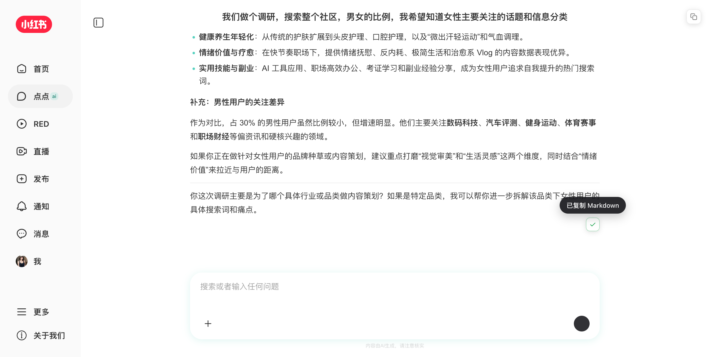

# 小红书 AI 对话 Markdown 复制器

在小红书「点点」（AI 对话）里复制 Markdown：

- **单条消息**：鼠标移到消息上，消息下方出现复制按钮，点一下拿到 AI 回复的 **Markdown 原文**
- **整个对话**：点标题栏右上角的复制图标，把当前对话按固定格式导出成一份 Markdown

[](screenshot.png)

- 脚本文件：[xiaohongshu-ai-copy.user.js](xiaohongshu-ai-copy.user.js)
- GitHub 直装地址：<https://raw.githubusercontent.com/wyf0931/oma-userscripts/main/scripts/xiaohongshu-ai-copy/xiaohongshu-ai-copy.user.js>

## 为什么写它

小红书 AI 的回复是渲染过的富文本，直接选中复制会丢掉 `#` 标题、`-` 列表、`**加粗**` 这些 Markdown 结构，粘到笔记 / Obsidian / 文档里还得手工重排。

页面其实已经把 Markdown 原文放在 `.markdown-block` 的 `data-original-text` 属性里了，只是没给入口。这个脚本把单条回复和整个对话的原文都接出来。

## 用法

### 复制单条消息

1. 打开小红书 AI 对话页（`https://www.xiaohongshu.com/ai_chat`，底部导航里的「点点」）
2. 鼠标移到某条消息上，消息**下方**（与消息底边相接，不压住正文）出现复制图标
3. 点一下，图标变成对勾，旁边弹出「已复制 Markdown」

- AI 回复：复制 `.markdown-block[data-original-text]` 的完整原文；一条回复里有多段 Markdown 时按空行拼接
- 用户提问（低优先级）：页面不保留提问的 Markdown 原文，所以复制的是气泡里的纯文本
- 复制内容会去掉原文里的零宽字符（`\u200b` 等），避免粘到编辑器里出现看不见的空隙
- 正在流式生成的回复也可以复制，拿到的是点击那一刻已经生成的内容

### 复制整个对话

标题栏右侧（标题右边）有一个常驻的复制图标，点一下按轮次导出整段对话，提示「已复制整个对话（N 轮）」。

输出格式固定为 `user input` / `assistant` 交替，没有额外 UI 文案：

```markdown
user input: 第一个问题

assistant:

## AI 回复的 Markdown 原文

- 列表
- 列表

user input: 第二个问题

assistant:

...
```

说明：

- 只导出页面里**已经加载**的轮次（不自动滚动、不调接口）；往上翻加载出来的历史会一起导出
- 一轮里有多个 AI 回复时合并到同一个 `assistant:` 块，用空行分隔
- 空消息会被跳过；用户提问的多行文本原样保留
- 正在流式生成的回复按当前已生成的内容导出

## 实现要点

- 两个复制按钮都是挂在 `body` 上的**单例浮层**，不往 Vue 管理的节点里插 DOM
  - 流式输出时消息组件频繁重渲染，插进去的按钮会被 patch 掉、来回闪烁
  - 单条按钮用 `pointermove` 找最近的 `.xhs-ai-md-container` / `.user-message`，再按 `getBoundingClientRect()` 定位到消息底边下方 2px、右边对齐
  - 用户消息要拿 `.user-message__text`（真正有气泡背景的元素）算位置：`.user-message` 自带 20px `padding-bottom`，直接用它会低 22px、压到下一轮消息
  - 长消息滚动 / 窗口缩放 / 回复继续变长时，按钮每 250ms 重新贴合；消息底部在视口外时钳到视口内，并避开浮在底部的输入框
- 整段按钮锚定 `.sticky-title-container`（标题栏），垂直居中、距右侧 16px；非 AI 对话页或空对话时自动隐藏
  - 用 `MutationObserver`（350ms 节流）跟随 SPA 路由、新建会话、对话加载
- 整段对话按 `.round-item` DOM 顺序读取，每轮取用户文本 + 所有 `.ai-message` 的 Markdown 原文
- 复制优先 `navigator.clipboard.writeText`，不可用时降级为隐藏 `textarea` + `execCommand('copy')`
- 不使用 `GM_*` API，不联网、不注入远程代码

## 已知限制

- 依赖小红书当前 DOM（`.ai-message`、`.xhs-ai-md-container`、`.markdown-block[data-original-text]`、`.user-message`、`.round-item`、`.sticky-title-container`），改版后可能需要更新选择器
- 页面自己的悬浮操作条（`.xhs-ai-copy-bar` / `.xhs-user-copy-bar`）如果出现，位置可能和本脚本的按钮相邻；本脚本只负责「复制 Markdown 原文」，不替代页面的其它操作
- 用户提问只有纯文本可复制（页面没有下发原文）；图片、地图卡片等非文本内容不会被复制
- 整段复制只覆盖已加载的轮次；超长对话需要先往上滚动加载
- UI 文案为中文

## 更新日志

- **0.2.1** — 修复用户消息复制按钮定位偏低：`.user-message` 自带 20px 底部 padding，改用真正带气泡背景的 `.user-message__text` 计算位置，按钮现在紧贴气泡下沿（AI 消息位置不变）
- **0.2.0** — 新增标题栏「复制整个对话」按钮（`user input` / `assistant` 固定格式）；单条复制按钮从消息角落移到消息下方 2px，与消息相接不再压住正文
- **0.1.0** — 初版：悬停消息显示复制按钮，复制 AI 回复的 Markdown 原文，附带 Toast 与对勾反馈；同步支持用户提问的纯文本复制
